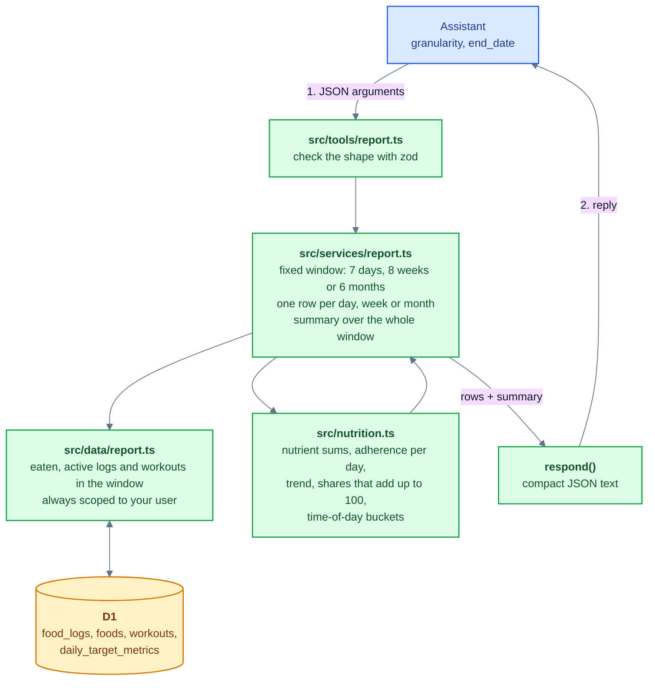

# get_report

How a report is built. The server reads the rows for the whole window once, adds everything up and judges every day against the targets, then replies with compact JSON. The assistant never adds numbers up, and draws any chart itself from the rows.

What is in the answer: a row per period (calories and where they came from, macros, fiber, sugar, added sugar, sodium, water, workouts, how many entries were estimated), and a summary with the trend, adherence to each target (days met and missed, streaks), the meal types and workout types over the whole window, one sentence to quote. Top foods are a separate tool: [get_top_foods](get-top-foods.md). The report needs every required daily target to be set: until then the call fails and names the missing ones. The week report also needs 7 days since the first log, and the month report 30. Archived and planned entries are left out, and today counts as in progress and is left out of adherence. If nothing at all was logged in the window the call fails and says where the user's data starts. For the individual foods of one day, `get_day` lists each with the local time it was eaten.

Colors: see the [legend](README.md#colors).
