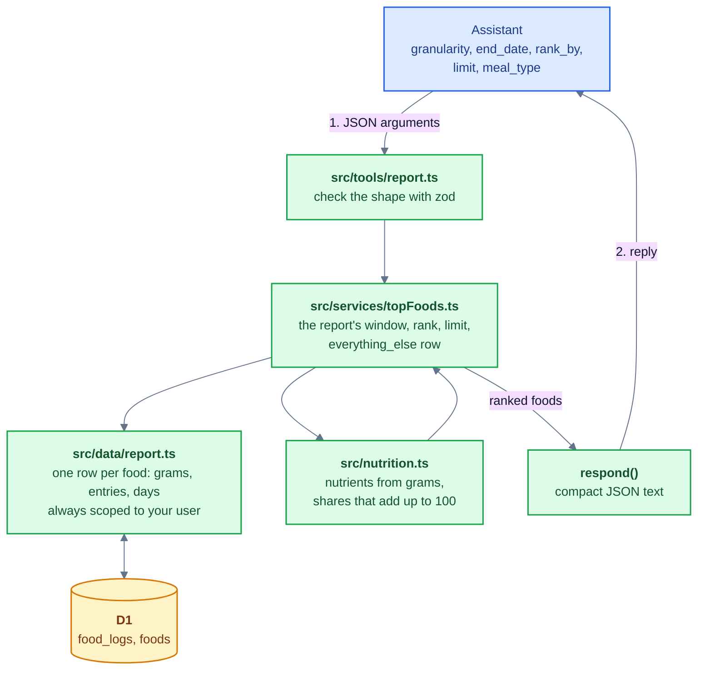

# get_top_foods

How a top-foods list is built. It uses the same window as `get_report` (7 days, 8 weeks or 6 months ending with `end_date`). The database only groups the logs by food; the server does the nutrient math, ranks the foods by the one metric asked for and makes the shares add up to 100.

What is in the answer: the foods ranked by `rank_by` (calories, protein, fat, carbs, fiber, sugar, added sugar, sodium, days eaten, entries or grams), each with its total for that metric (`value`), its share of the window total, days eaten, entries and grams, then an `everything_else` row when there are more foods than `limit`, so the shares add up to 100 (days eaten has no shares, since days overlap between foods). Water is left out, and `meal_type` limits the list to one meal. Archived and planned entries are left out. If nothing was logged in the window the call fails and says where the user's data starts. No targets are needed.

Colors: see the [legend](README.md#colors).
